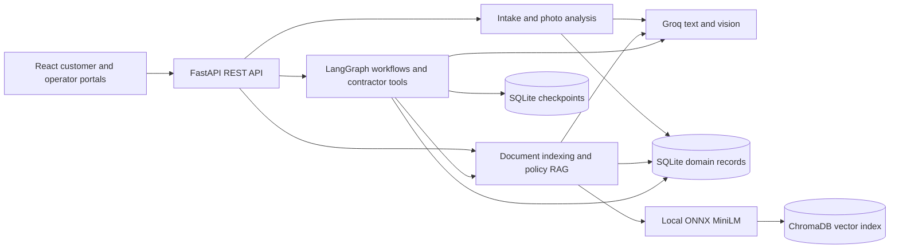
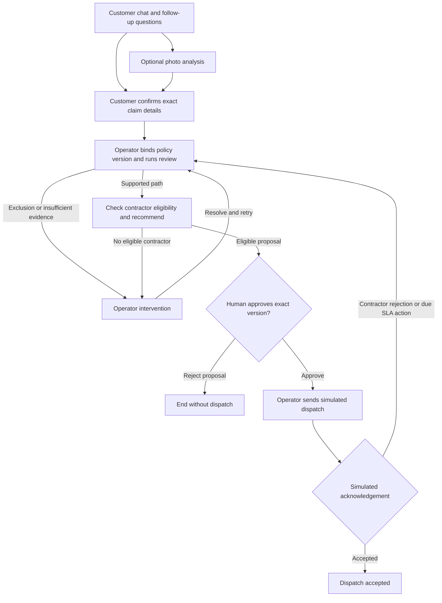
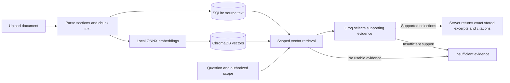
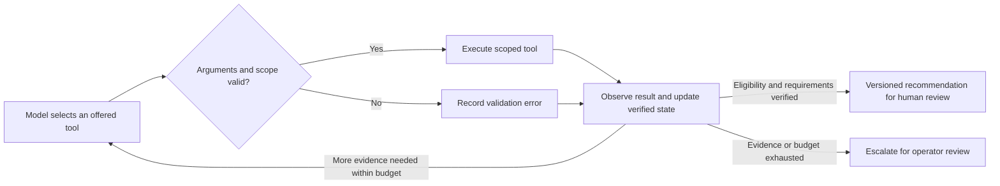

<div align="center">
  
  <h1>ClaimPilot AI</h1>
  <p>Property damage intake, cited policy review, and human-approved restoration coordination.</p>
  <p>
    
    
    
    
  </p>
  <p>
    <a href="https://claimpilot-ai-production.up.railway.app/"><strong>Live Demo</strong></a>
    &nbsp;·&nbsp;
    <a href="https://youtu.be/M-aCc89QPWc"><strong>Video Walkthrough</strong></a>
  </p>
  <a href="https://youtu.be/M-aCc89QPWc"></a>
</div>

## Contents

[Overview](#overview) · [Core AI capabilities](#core-ai-capabilities) · [Architecture](#architecture) · [Interactive demo guide](#interactive-demo-guide) · [Technology stack](#technology-stack) · [Repository structure](#repository-structure) · [Getting started](#getting-started) · [Evaluation and reliability](#evaluation-and-reliability) · [Security and engineering decisions](#security-and-engineering-decisions) · [Limitations and future improvements](#limitations-and-future-improvements) · [Documentation](#documentation)

## Overview

Property damage reports often begin with a short conversation, a few photos, and incomplete location or policy details. An insurance operator must turn that material into a confirmed report, find the applicable clauses, and decide whether a restoration provider can respond.

ClaimPilot links those steps in a shared workspace. The **customer** reports damage in chat, adds photos, answers follow-up questions, and explicitly confirms the report. The **insurance operator** binds a policy version, inspects the supporting clauses and contractor checks, and approves a specific recommendation before sending a simulated dispatch.

The LLM extracts facts, interprets photos, selects evidence, and chooses from bounded tools. Typed contracts, deterministic validation, scoped database queries, persistent workflow state, and human decisions control what the application accepts and executes.

## Core AI capabilities

| Capability | Implementation |
| --- | --- |
| Multi-turn intake | Pydantic validates structured extraction. Intake records message provenance, detects missing or conflicting facts, and asks contextual follow-ups. Deterministic checks flag malformed or ambiguous ZIPs before confirmation and handle explicit corrections. |
| Multimodal damage analysis | Groq vision describes visible damage, limitations, and tentative interpretations from normalized photos. The customer controls confirmed claim facts. |
| Custom document ingestion and RAG | PDF, DOCX, TXT, and Markdown become stored sections and chunks. Local ONNX MiniLM embeddings drive ChromaDB retrieval within the authorized document or policy scope. The answer model selects evidence, the server returns exact stored excerpts, and unsupported questions receive an insufficient-evidence outcome. |
| Dynamic contractor tool calls | The model chooses from search, availability, arrival, performance, and dispatch-requirement tools. The server validates arguments and applies eligibility, urgency, and SLA rules before publishing a versioned proposal. |
| Persistent human review | LangGraph checkpoints preserve review, approval, and acknowledgement pauses. Contractor rejection or a due SLA action can trigger reassignment and fresh approval. Missing evidence, stale proposals, and failed checks can route to operator intervention. |
| Evaluations and observability | Labeled fixtures and live spot checks cover extraction, retrieval, citations, escalation, and tool selection. The operator UI shows tool calls and results, model turns, timings, and reported token usage when available. |

## Architecture

### System architecture



### Claim lifecycle



### Retrieval and grounded answers



### Contractor tool loop



## Interactive demo guide

Choose **Customer Portal** or **Claims Operator** for direct access. The first portal visit creates an isolated workspace. Both roles share that workspace in the same browser tab, including after refresh while the session is valid. Use synthetic information and sample images. [Live Demo](https://claimpilot-ai-production.up.railway.app/)

### Connected walkthrough

1. Select **Dishwasher leak** and click **Try Interactive Demo**. Use the suggested replies and **Send message**. Choose **Use sample image** to try photo analysis. Sample policies index in the background.
2. Review the checklist, select the confirmation checkbox, click **Confirm claim details**, then **Continue to Insurance Review**.
3. If prompted to explore a separate document, import it or return to the claim. Select the suggested *v1*, click **Bind policy version**, and use **Assess policy & view citations** or **Start workflow**. Open **AI Activity** and **Tools the agent used** to inspect arguments, tool results, and model turns.
4. Enter a reason, click **Approve exact version**, then **Send simulated dispatch**. Choose **Simulate acceptance** to finish or **Reject and find replacement** to exercise reassignment. If a replacement is available, review and approve its new version before sending again.

**Policy exclusion** and **No contractor available** demonstrate operator intervention paths.

### Independent demonstrations

| Choose under **Explore a capability** | Try this |
| --- | --- |
| **Conversational AI** | Send *There is water damage in the kitchen.* For location, try *9810*. The incomplete ZIP keeps the location unresolved. Reply *98101* when asked for the service ZIP. |
| **Multimodal Damage Analysis** | Choose **Use sample image** or upload a synthetic photo. Compare visible observations, possible hazards, and limitations. |
| **Custom Knowledge Base & RAG** | The library starts empty. Choose a file, click **Upload my document**, select it, and use **Ask this document** with a question answered by its text. For a repeatable example, click **Import sample policy** and ask *What does Coverage for sudden appliance leaks say?* Then ask *Does this policy cover stolen bicycles?* to try abstention. |
| **Agentic Workflow** | Review the prepared sample claim and explicitly confirm it. Follow the policy and contractor review steps above, then inspect the tool trace or reject a simulated dispatch to request a replacement. |

## Technology stack

| Layer | Technologies |
| --- | --- |
| Frontend | React 19, TypeScript, Vite, React Router, TanStack Query, Tailwind CSS |
| Backend and validation | Python 3.11, FastAPI, Uvicorn, Pydantic, Pillow |
| AI orchestration and inference | LangChain, LangGraph checkpoints and interrupts, Groq text and vision models |
| Retrieval and storage | ONNX Runtime and all-MiniLM-L6-v2, ChromaDB, SQLite |
| Testing and evaluation | pytest, FastAPI TestClient, labeled fixtures, recorded live checks and browser smoke tests |
| Deployment | Multi-stage Docker build, Railway, same-origin SPA and API, persistent runtime volume |

## Repository structure

```text
claimpilot-ai/
├── claimpilot/
│   ├── agents/        # Intake, contractor tools, and workflow orchestration
│   ├── api/           # Claimant and operator FastAPI routes
│   ├── prompts/       # Extraction, vision, retrieval, and tool prompts
│   ├── schemas/       # Pydantic contracts and validation
│   ├── services/      # Inference, parsing, indexing, and domain logic
│   ├── storage/       # SQLite stores and demo cleanup
│   ├── hosted_demo.py # Public sessions, expiry, and quotas
│   └── main.py        # Application factory and HTTP entry point
├── frontend/          # React portals, walkthrough, and public samples
├── data/              # Synthetic policies, contractors, and evaluation labels
├── examples/          # Local demo, evaluation, and capability scripts
├── tests/             # Backend regressions and hosted session tests
├── docs/              # Architecture, deployment, evaluation, and API guides
├── Dockerfile
├── pyproject.toml
└── uv.lock
```

## Getting started

Install Git, Python 3.11, uv, and Node.js 22.12+ with npm. The Docker build uses Node 24. These commands run from PowerShell. Use `npm` in place of `npm.cmd` in a POSIX shell.

```powershell
git clone https://github.com/AbhishekTiwari14/claimpilot-ai.git
cd claimpilot-ai
uv sync --locked --group agents
npm.cmd --prefix frontend ci
```

### Run the interactive demo

Start the offline backend from the repository root. It uses fixture inference and lexical embeddings. Follow the included sample inputs in offline mode.

```powershell
uv run --locked --group agents python -m examples.frontend_demo --interactive
```

For live Groq inference, copy the sample environment file and set `GROQ_API_KEY` in the root `.env` before starting the backend. Live mode supports custom reports, photos, and arbitrary grounded questions. The first live index can download the CPU embedding model.

```powershell
Copy-Item .env.example .env
uv run --locked --group agents python -m examples.frontend_demo --interactive --provider groq
```

Use `cp .env.example .env` in a POSIX shell. Start the frontend in a second terminal and open `http://127.0.0.1:5173`.

```powershell
npm.cmd --prefix frontend run dev -- --host 127.0.0.1 --port 5173
```

The frontend proxies API calls to port 8000. For the standard backend with manual role credentials, use `uv run --locked --group agents uvicorn claimpilot.main:app` and configure the tokens as described in the frontend reference. [Frontend demo reference](docs/FRONTEND.md)

### Docker and tests

Build and run a local routing smoke test. For hosted interactive mode, configure `.env.docker` from `.env.docker.example`, set the public HTTPS origin and trusted proxy, and mount the writable `/runtime` volume. [Deployment guide](docs/DEPLOYMENT.md)

```sh
docker build -t claimpilot-ai .
docker volume create claimpilot-runtime
docker run --rm -p 127.0.0.1:8000:8000 -v claimpilot-runtime:/runtime claimpilot-ai
```

```powershell
uv run --locked --group agents pytest
npm.cmd --prefix frontend run typecheck
npm.cmd --prefix frontend run build
```

## Evaluation and reliability

| Evidence | Sample | Recorded result |
| --- | --- | --- |
| Offline fixture extraction | 3 synthetic inputs | 3/3 expected results |
| Offline fixture RAG | 8 labeled questions | Hit@5 on 5/5 relevant cases, 4/4 valid named-clause citations, 3/3 abstention and scope checks |
| Offline fixture contractor tools | 5 synthetic scenarios | 13/13 valid tool executions, 2/2 eligible recommendations, 3/3 correct escalations, zero unauthorized actions |
| Live Groq RAG | 8 labeled questions | 8/8 expected outcomes, 5/5 Hit@5, 6/6 valid citations with exact excerpts |
| Live Groq contractor tools | 2 recorded traces | Eligible case reached approval in 8 model turns. Empty search escalated in 3 turns. |
| Backend regression | Full suite after hosted deployment support | 154/154 passed. The earlier UI snapshot records 134/134. Subsequent focused runs are separate. |
| Browser smoke | Local browser with deliberately held indexing | Chat rendered while indexing was active. The smoke covered concurrent intake, failed-index recovery, refresh without duplicate uploads, an empty standalone RAG library, and explicit confirmation for the workflow sample. |

Before background indexing, Railway logs showed about **24 seconds** across workspace creation, four sample ingestion requests, and conversation creation. After the change, chat appeared in **413 ms** in the local browser smoke test while indexing was held open. Production timing after the fix is unmeasured here. [Evaluation methods and denominators](docs/EVALUATION.md)

## Security and engineering decisions

- **Workspace and role isolation.** FastAPI resolves claimant ownership and operator workspace scope from distinct server-issued bearer credentials. Hosted visitors use expiring, workspace-scoped credentials stored in the browser tab. The Groq key stays server-side.
- **Prompt and tool boundaries.** Prompts treat reports, photos, and document text as untrusted data. Structured outputs are validated with Pydantic and domain rules. The contractor loop limits offered tools and strictly checks arguments and record scope. The RAG model selects numbered evidence and the server resolves it to authorized excerpts.
- **Versioned decisions and recovery.** Idempotency keys protect retries. LangGraph checkpoints persist operator pauses. Dispatch revalidates current evidence, eligibility, and the exact approved proposal version.
- **Public demo limits.** Defaults include a one-hour session, workspace creation quotas, two concurrent writes globally, request and upload quotas, and model-call budgets. The application purges expired workspace data. [Hosted defaults and storage](docs/DEPLOYMENT.md)
- **Storage choices.** SQLite keeps transactional claim state and checkpoints on a single host with few moving parts. ChromaDB keeps a rebuildable vector projection beside the local embedding cache. SQLite remains the source of truth for text and provenance.

## Limitations and future improvements

Policies and contractors are synthetic. Coverage assessments are advisory and dispatch is simulated. Evaluation sets are small and synthetic. Hosting targets a single server and worker. Operators trigger SLA processing. Production use would require broader held-out evaluations, production identity, operational monitoring and recovery drills, and an audited dispatch integration.

## Documentation

- [Architecture and workflow safeguards](docs/ARCHITECTURE.md) · [Deployment and limits](docs/DEPLOYMENT.md) · [Evaluation](docs/EVALUATION.md)
- [Frontend and local sessions](docs/FRONTEND.md) · [Implementation history](docs/IMPLEMENTATION_PLAN.md)
- [Intake API](docs/INTAKE_API.md) · [Photo API](docs/PHOTO_API.md) · [Knowledge API](docs/KNOWLEDGE_API.md) · [Contractor and workflow API](docs/CONTRACTOR_API.md)
