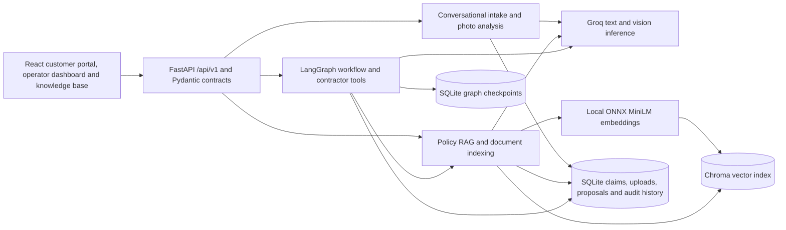
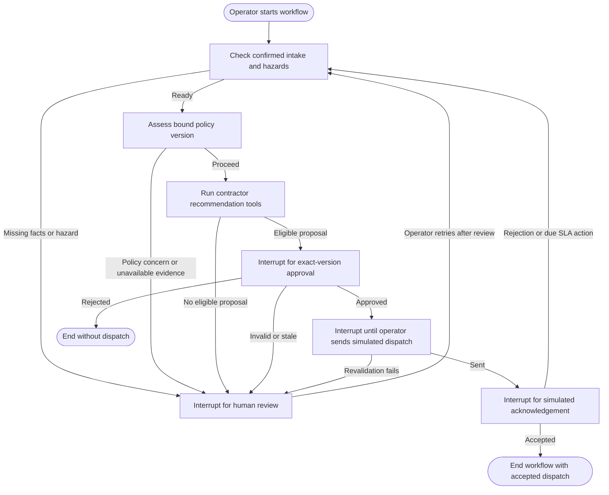

# ClaimPilot AI architecture

## Runtime architecture

Offline mode substitutes fixture inference and, in the frontend demo runner, lexical embeddings. The browser calls typed REST endpoints. FastAPI uses separate bearer credentials for claimants and operators, and resolves workspace membership server-side. Claims are scoped to their owner and workspace. The local interactive launcher issues both roles for each isolated synthetic visitor workspace.

- **Intake.** The model extracts report excerpts under a structured contract. The application merges candidates with message provenance, applies explicit corrections, asks about unresolved facts and requires version-bound customer confirmation. Immediate hazard handling uses application rules.
- **Photos.** The API validates image content and limits bytes, dimensions and decoded pixels. Accepted images are normalized to JPEG with metadata stripped. Observations and tentative interpretations stay separate from confirmed facts. Deleting a photo invalidates dependent analyses.
- **Knowledge.** Extraction supports PDF, DOCX, TXT and Markdown. SQLite holds document metadata and authoritative text. Chroma is a rebuildable projection. Retrieval is scoped by workspace and document scope, including policy ID and version where applicable. Document content is untrusted. The answer model has no tools and selects evidence by number. The server resolves selections to authorized stored clauses and returns exact excerpts. Policy assessment is advisory and can route conflicting or insufficient evidence to human review.
- **Contractors.** A bounded Groq tool loop retrieves scoped records for search, availability, arrival estimates, performance and requirements. Result IDs correlate tool outputs with subsequent model turns. Application rules determine urgency, eligibility and SLA requirements. Only the bundled operations handbook can supply authoritative synthetic dispatch requirements. The final proposal is validated, versioned and expiring.

## LangGraph workflow

The graph persists native interrupts in a sibling SQLite checkpoint database so the authorized operator can resume a run after restart when its storage and credentials persist. Dispatch revalidates approval and eligibility transactionally. Idempotency keys, version checks, dispatch attempt records and a SQLite workflow lock protect retry and reentry. Reassignment can produce a new proposal that requires fresh approval. SLA processing is operator-triggered and uses the server clock. [Graph implementation](../claimpilot/agents/workflows.py)

## Safeguards and trade-offs

| Safeguard or decision | Trade-off |
| --- | --- |
| Workspace-scoped bearer credentials, scoped evidence lookups and typed validation | Credentials suit a local pilot. A public demo needs expiring visitor sessions, abuse controls and isolation tests. |
| Model suggestions, deterministic routing and versioned human approval | Operators retain control at each consequential step. Ambiguity and stale proposals require intervention. |
| SQLite domain state and separate graph checkpoints, with Chroma as a derived index | Few moving parts for a single host. Workflow locking and synchronous provider or indexing calls constrain concurrency. Backups must preserve consistent domain and checkpoint state. |
| Whole-clause citations resolved by the server | Citations retain conditions and provenance. Semantic support still needs evaluation and operator judgment. |
| Bounded model retries, sanitized trace metadata and synthetic fixtures | Offline runs are reproducible. Live responses, latency, rate limits and ambiguous inputs require broader validation. |

The pilot ends at simulated acknowledgement and reassignment. Arrival and completion tracking, scheduled SLA processing, formal claim reports, OCR for scanned PDFs, production identity and live dispatch are future work. Real claim handling would also require privacy and retention controls, operational monitoring, recovery drills, and broader held-out evaluations. [Deployment audit](DEPLOYMENT.md) · [Implementation history](IMPLEMENTATION_PLAN.md)

## Design references

The initial design drew on documented patterns for specialized agents, bounded tools and review gates. ClaimPilot implements a separate property restoration workflow. [Insurance Agentic AI](https://github.com/mohanhundre1/insurance-agentic-ai#architecture) · [ClaimLens](https://github.com/kb2326/claimlens)
